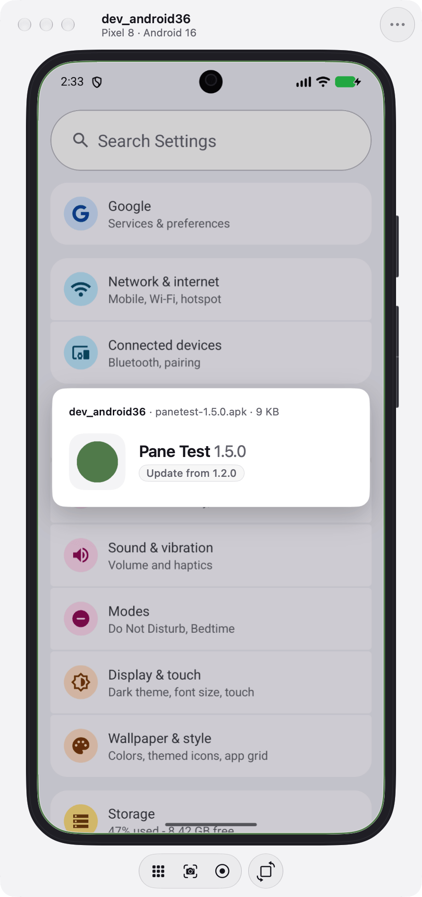
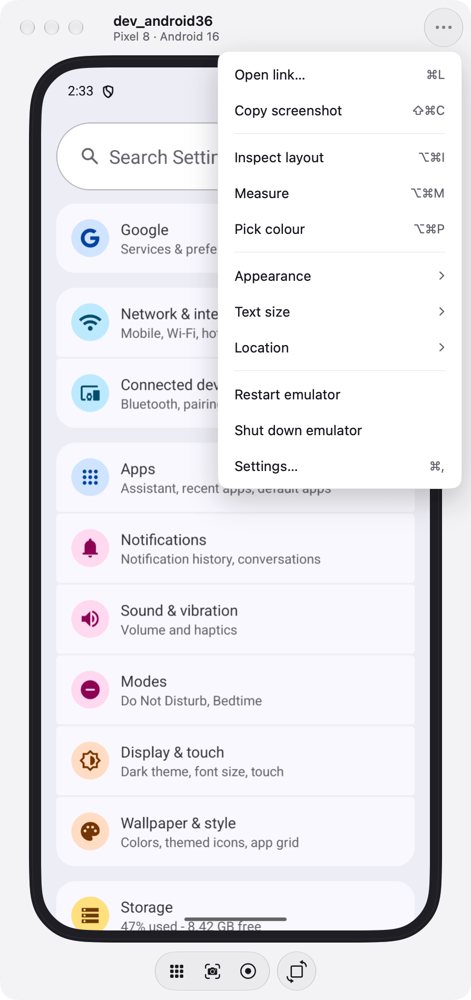

# Pane: Android emulator window

The Android emulator in a clean Mac window, inside a device frame.

Pane shows a running Android emulator in its own window, inside a phone frame it draws to fit the screen. Click, scroll and type as you would on the phone. The emulator itself runs without a window of its own.

A [Nidus Labs](https://niduslabs.dev) app. *A home for little ideas.*

<p align="center">
<picture>
<source media="(prefers-color-scheme: dark)" srcset="docs/screenshots/window-dark.png">
<source media="(prefers-color-scheme: light)" srcset="docs/screenshots/window-light.png">

</picture>
</p>

## What it does

- **Mirror:** the emulator in one window, inside a frame drawn to fit its screen. Clicks, scrolls and keys go to the emulator, and the frame's power and volume buttons work.
- **Tools:** Inspect layout shows a view's frame, size and id in dp. Measure draws a line between two points and snaps to view edges. Pick colour copies a pixel's hex value.
- **Drag and drop:** drop an `.apk` on the screen to install it. Pane shows whether it's new, an update or older before you let go. Other files are copied to the device's Download folder.
- **Clipboard:** text you copy on the device reaches the Mac while Pane is in front, and Command-V in Pane pastes the Mac's text on the device.
- **Screenshots and recordings:** save or copy a screenshot, with the device frame if you want it. Recordings show a timer while they run, and any recording can be exported as a GIF.
- **Windows:** sizes like the iOS Simulator (Physical Size, Point Accurate, Pixel Accurate, Fit Screen). Click the device name to switch emulators, or open another one in a new window: one window per emulator.

<p align="center">
<picture>
<source media="(prefers-color-scheme: dark)" srcset="docs/screenshots/inspect-layout-dark.png">

</picture>
<picture>
<source media="(prefers-color-scheme: dark)" srcset="docs/screenshots/drag-update-dark.png">

</picture>
<picture>
<source media="(prefers-color-scheme: dark)" srcset="docs/screenshots/more-menu-dark.png">

</picture>
</p>

## Install

Download [Pane.dmg](https://github.com/niduslabs-dev/pane/releases/latest/download/Pane.dmg), open it and drag Pane to Applications. Needs macOS 15 or later. Pane is signed with a Developer ID and notarized by Apple, and it updates itself.

## Needs

- The Android SDK with its emulator installed, and at least one virtual device. Pane works with the Android emulator only, not physical phones or the iOS Simulator.
- **Emulator 37.3.9 or later (beta channel) is recommended.** Emulator 37.2.13, the current stable build, can crash while anything streams its screen, Pane and Android Studio included. To install the beta:

  ```sh
  sdkmanager --sdk_root="$HOME/Library/Android/sdk" --channel=1 emulator
  ```

## Show all emulators in Pane

A setting in Pane's Settings, off by default. When it's on, an emulator started anywhere, such as from Expo or a terminal, opens in Pane without its own window.

It changes your shell setup, so here is what it does:

- It creates a wrapper SDK folder at `~/Library/Android/pane-sdk`. The folder links to your real SDK. Only the emulator launcher is replaced: it adds `-no-window` and opens Pane on that emulator.
- It adds a small marked block to `~/.config/fish/config.fish`, `~/.zprofile` and `~/.zshrc` that points `ANDROID_HOME` at the wrapper folder. Pane backs up each file first. Other shells are left alone.

Turn the setting off and Pane removes the block and the folder. If Pane is missing, the wrapper runs the real emulator unchanged. While it's on, install SDK packages from Android Studio, or pass `--sdk_root` to `sdkmanager` as above.

## How it works

- **The emulator's own interface:** Pane talks to the emulator over its gRPC service (`EmulatorController`), the one Android Studio uses. It finds running emulators from the files the emulator writes when it starts, and connects with that emulator's own token.
- **Headless:** Start launches a virtual device with `-no-window`, so Pane's window is the only one. Quitting Pane leaves emulators running, and Pane only ever stops an emulator it started.
- **Installs and files** go through the SDK's own `adb`. Inspect layout reads the screen's layout with `uiautomator`.
- **Private:** no account and no analytics. Pane sends nothing anywhere except its daily check for its own updates on GitHub.

## Building

Needs Xcode 27 or later on macOS 15 or later.

```sh
scripts/swift.sh build
scripts/swift.sh test
scripts/build-app.sh [--debug]
```

`scripts/swift.sh` runs `swift` with Homebrew's LLVM build settings removed, which otherwise break Xcode's toolchain. `scripts/build-app.sh` assembles `build/Pane.app`, signed ad hoc. Builds signed this way don't update themselves.

## Releases and updates

Releases are signed with Developer ID, notarized by Apple and published on [GitHub Releases](https://github.com/niduslabs-dev/pane/releases) by a workflow, never from a laptop. Pane updates itself with [Sparkle](https://sparkle-project.org): once a day it checks the latest release's `appcast.xml`, downloads in the background, verifies the EdDSA signature and installs when Pane quits, or straight away with Restart to update. Pane isn't sandboxed: the sandbox would block the folder where emulators register themselves.

## Contributing

Not taking code contributions yet. Bug reports are welcome as issues. Include your emulator version (`emulator -version`) and the AVD's device and Android version.

## Licence

[GPL-3.0](LICENSE). Copyright Nidus Labs.
