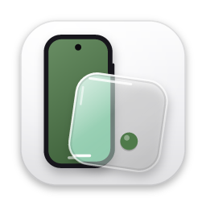
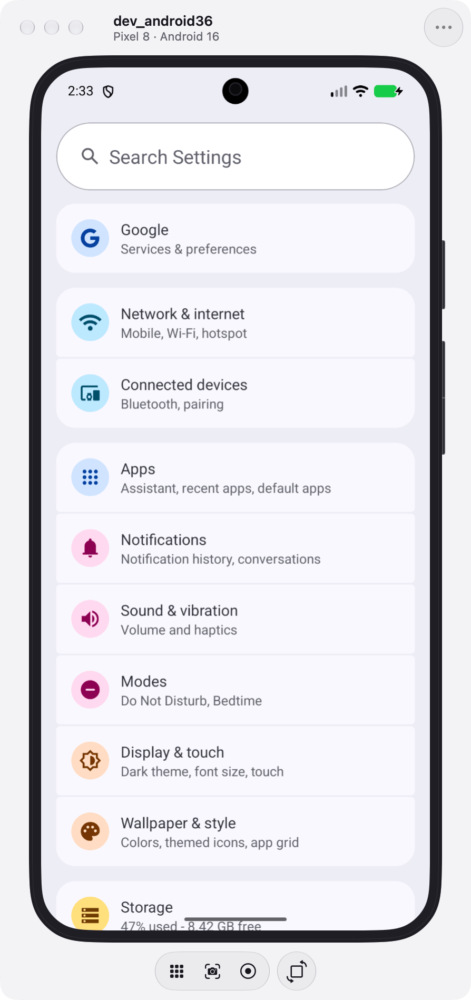
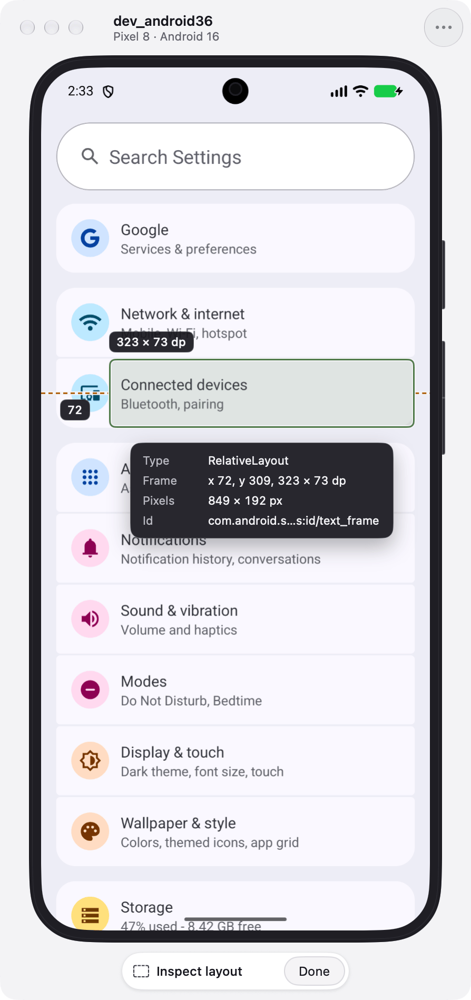

<div align="center">

  

  <h1>Pane</h1>

  <p><b>The Android emulator in a clean Mac window.</b></p>

  <p>
    A free, open-source Mac app that shows a running Android emulator inside a device frame it draws.<br/>
    Click, scroll and type as you would on the phone.
  </p>

<p>
  <a href="https://niduslabs.dev/pane"></a>
  <a href="https://github.com/niduslabs-dev/pane/releases/latest"></a>
  <a href="https://github.com/niduslabs-dev/pane/releases"></a>
  <a href="LICENSE"></a>
</p>

  <p>
    <a href="https://github.com/niduslabs-dev/pane/releases/latest/download/Pane.dmg"><b>Download</b></a>
    &nbsp;·&nbsp;
    <a href="#install"><b>Install</b></a>
    &nbsp;·&nbsp;
    <a href="#build-from-source"><b>Build from source</b></a>
    &nbsp;·&nbsp;
    <a href="#privacy"><b>Privacy</b></a>
  </p>

  <a href="docs/screenshots/window-light.png">
    <picture>
      <source media="(prefers-color-scheme: dark)" srcset="docs/screenshots/window-dark.png">
      <source media="(prefers-color-scheme: light)" srcset="docs/screenshots/window-light.png">
      
    </picture>
  </a>

  <p><i>A Pixel 8 emulator on Android 16, in Pane.</i></p>

</div>

---

The emulator runs without a window of its own, and Pane shows it in one clean window. It talks to the emulator over the emulator's own interface, so nothing is installed on the device to make it work.

A [Nidus Labs](https://niduslabs.dev) app. *A home for little ideas.*

---

## Features

### Mirror

- **One window per emulator:** the screen sits inside a frame drawn to fit it, in any of the four orientations.
- **Input:** clicks, scrolls and keys go to the emulator. The frame's power and volume buttons work.
- **Clipboard:** text you copy on the device reaches the Mac while Pane is in front. Command-V in Pane pastes the Mac's text on the device.

### Tools

- **Inspect layout:** click a view to see its frame, size and id in dp, with its distances to the edges of its parent or the screen.
- **Measure:** drag a line between two points. It snaps to view edges, and Shift keeps it level or upright.
- **Pick colour:** a loupe follows the pointer, and a click copies the device's own pixel as a hex value.
- **Device settings:** Appearance, Text size and Location from the More menu, and Open link to send a URL to the device.

### Drag and drop

- **Apps:** drop an `.apk` on the screen to install it. Before you let go, Pane says whether it's new, an update, older or the same version.
- **Files:** anything else is copied to the device's Download folder.

### Capture

- **Screenshots:** save or copy, with the device frame if you want it.
- **Recordings:** H.264 `.mov` files, with a timer in the toolbar while they run. Any recording can be exported as a GIF.

### Windows

- **Sizes like the iOS Simulator:** Physical Size, Point Accurate, Pixel Accurate and Fit Screen.
- **Switcher:** click the device name to show another emulator in this window, or open it in a new one.
- **Headless start:** Start launches a virtual device with no emulator window. Quitting Pane leaves emulators running.

<p align="center">
<picture>
<source media="(prefers-color-scheme: dark)" srcset="docs/screenshots/inspect-layout-dark.png">

</picture>
<picture>
<source media="(prefers-color-scheme: dark)" srcset="docs/screenshots/drag-update-dark.png">

</picture>
<picture>
<source media="(prefers-color-scheme: dark)" srcset="docs/screenshots/more-menu-dark.png">

</picture>
</p>

### Keyboard shortcuts

| Shortcut | Action |
|---|---|
| ⌘N | New window, for an emulator that doesn't have one |
| ⌘E | Switch emulator |
| ⌘L | Open link |
| ⌘S | Save screenshot |
| ⇧⌘C | Copy screenshot |
| ⌥⌘I | Inspect layout |
| ⌥⌘M | Measure |
| ⌥⌘P | Pick colour |
| ⌘1 to ⌘4 | Physical Size, Point Accurate, Pixel Accurate, Fit Screen |
| ⌘+ and ⌘- | Zoom in and out |
| Esc | End the tool that's on |
| ⌘, | Settings |

Other keys go to the emulator while Pane's window is in front.

---

## Install

1. Download [Pane.dmg](https://github.com/niduslabs-dev/pane/releases/latest/download/Pane.dmg).
2. Open it and drag Pane to Applications.
3. Open Pane. It finds running emulators by itself, or click Start to launch one.

Pane is signed with a Developer ID and notarized by Apple.

> [!TIP]
> Use emulator 37.3.9 or later (the beta channel). Emulator 37.2.13, the current stable build, can crash while anything streams its screen, Pane and Android Studio included. To install the beta:
>
> ```sh
> sdkmanager --sdk_root="$HOME/Library/Android/sdk" --channel=1 emulator
> ```

### Show all emulators in Pane

> [!NOTE]
> An optional switch in Pane's Settings, off by default. When it's on, an emulator started anywhere, such as from Expo or a terminal, opens in Pane without its own window. To do that it changes your shell setup:
>
> - It creates a wrapper SDK folder at `~/Library/Android/pane-sdk` that links to your real SDK. Only the emulator launcher is replaced.
> - It adds a marked block to `~/.config/fish/config.fish`, `~/.zprofile` and `~/.zshrc` that points `ANDROID_HOME` at the wrapper. Each file is backed up first, next to it, as `<file>.pane-backup-<date>`.
>
> Turning the switch off removes the block and the folder. If Pane is missing, the wrapper runs the real emulator unchanged. While it's on, install SDK packages from Android Studio, or pass `--sdk_root` to `sdkmanager` as above.

---

## Updating

Pane updates itself with [Sparkle](https://sparkle-project.org). Once a day it checks the latest release on GitHub. With "Install updates automatically" on (the default), it downloads in the background and installs when Pane quits. Click **Restart to update** to install straight away. To check now, choose **Check for Updates…** in the Pane menu.

---

## Uninstalling

1. If **Show all emulators in Pane** is on, turn it off in Settings first. That removes the wrapper folder and the shell block.
2. Quit Pane and move it from Applications to the Trash.
3. Optionally, delete what it leaves behind:
   - `~/Library/Preferences/dev.niduslabs.pane.plist` (settings and window positions)
   - `~/Library/Caches/dev.niduslabs.pane` and `~/Library/HTTPStorages/dev.niduslabs.pane` (update checks)
   - `~/Library/Logs/Pane` (output of emulators Pane started)
   - the `.pane-backup-<date>` copies next to your fish and zsh config files, if you used the switch

Your emulators, virtual devices and Android SDK are not touched.

---

## Build from source

### Prerequisites

- macOS 15 or later
- Xcode 27 or later
- The Android SDK with its emulator, to run it

### Steps

1. Clone the repo:

   ```sh
   git clone https://github.com/niduslabs-dev/pane.git
   cd pane
   ```

2. Build and test:

   ```sh
   scripts/swift.sh build
   scripts/swift.sh test
   ```

3. Assemble the app:

   ```sh
   scripts/build-app.sh            # build/Pane.app
   scripts/build-app.sh --debug    # a debug build
   ```

4. Open `build/Pane.app`.

`scripts/swift.sh` runs `swift` with Homebrew's LLVM build settings removed, which otherwise break Xcode's toolchain. Local builds are signed ad hoc and don't update themselves.

---

## Requirements

- macOS 15 or later
- The Android SDK with its emulator, and at least one virtual device
- Emulator 37.3.9 or later recommended (see the tip under [Install](#install))

Pane works with the Android emulator only. It does not show physical phones or the iOS Simulator.

---

## Privacy

- No account and no analytics.
- Pane goes online only to check GitHub for its own updates.
- Everything else stays on your Mac: Pane talks to the emulator over its local gRPC interface and to the device through the SDK's own `adb`.
- Clipboard text moves only while Pane's window is in front, and is never logged.

---

## Security

- Releases are signed with a Developer ID and notarized by Apple. They're built by a GitHub workflow, never on a laptop.
- Updates are verified with Sparkle's EdDSA signature before they install.
- Pane connects to each emulator with that emulator's own access token and never logs it.
- Pane isn't sandboxed: the sandbox would block the folder where emulators register themselves.

Found a security problem? Email [support@niduslabs.dev](mailto:support@niduslabs.dev) rather than opening a public issue.

---

## Contributing

Not taking code contributions yet. Bug reports are welcome as [issues](https://github.com/niduslabs-dev/pane/issues). Include your emulator version (`emulator -version`) and the virtual device's model and Android version.

---

## License

[GPL-3.0](LICENSE). Copyright Nidus Labs.

---

## Support

Questions or problems: [support@niduslabs.dev](mailto:support@niduslabs.dev).

---

<div align="center">

<a href="https://niduslabs.dev"><b>Made by Nidus Labs</b></a><br/>
<i>A home for little ideas.</i>

</div>
